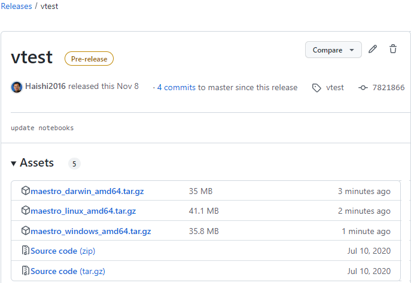

<!--
Copyright (c) Microsoft Corporation.
Licensed under the MIT license.
SPDX-License-Identifier: MIT
-->
# Build up CLI and release

_(last edit: 10/24/2024)_

To build up Maestro CLI and release with Symphony API and samples.
The build uses mage to automate the process. Please refer to  [Build CLI](../docs/symphony-book/cli/build_cli.md) if manual steps are preferred.

## Prerequisites
1. If you are doing this from WSL/Ubuntu, install `zip`.

   ```bash
   sudo apt-get install zip unzip -y
   ```
2. Update maestro version.

   Update the `SymphonyAPIVersion` constant under `cli/cmd/up.go` to reflect the latest Symphony version.

## Mage Commands
See all commands with mage -l
```
# under symphony/cli folder
> mage -l
Use this tool to quickly build symphony API or maestro CLI. It can also help generate the release package.

Targets:
  buildApi            Build Symphony API for Windows, Mac and Linux.
  buildCli            Build maestro CLI tools for Windows, Mac and Linux.
  generatePackages    Generate packages with Symphony API, maestro CLI and samples for Windows, Mac and Linux.
```
Samples
```
# under symphony/cli folder
# Build up Symphony API for Windows, Mac and Linux. You can find the binary files in symphony/api folder
mage buildApi

# Build up Maestro CLI for Windows, Mac and Linux. You can find the binary files in symphony/cli folder
mage buildCli

# Build up Symphony API and Maestro CLI for Windows, Mac and Linux. Copy the binary files, samples and configuration files to the specified folder and generate the release package. You will find maestro_windows_amd64.zip, maestro_darwin_amd64.tar.gz and maestro_linux_amd64.tar.gz in the specified folder.
mage generatePackages /home/usr/assemble
```

## Local agent status demo

Maestro can run the control plane, an optional local test MQTT broker, and a
separate agent process without Kubernetes. The agent registers a Target and
reports its locally configured property bag over MQTT. A third terminal can
watch the resulting Target status.

Prerequisites:

* A Go toolchain compatible with the repository's modules.
* The native `mosquitto` executable on `PATH`, or an explicit `--mqtt-binary`
  path. The CLI does not install software or require Docker for this workflow.
* Available HTTP and MQTT ports. The repository's standalone API configuration
  uses HTTP port 8082; the commands below use MQTT port 18883.

Build **both binaries from this checkout** so the API/agent binary contains the
new status vendor. From the repository root, on Linux/macOS:

```bash
mkdir -p /tmp/symphony-demo
(cd api && go build -o /tmp/symphony-demo/symphony-api .)
(cd cli && go build -o /tmp/symphony-demo/maestro .)
```

Run all three terminals as the same user, from the repository root, so they share
the Maestro context in `~/.symphony/.config.json`.

### Terminal 1: control plane and test broker

```bash
/tmp/symphony-demo/maestro up --no-k8s \
  --api-binary /tmp/symphony-demo/symphony-api \
  --api-config ./api/symphony-api-no-k8s.json \
  --with-mqtt-broker --mqtt-port 18883
```

Wait for `Symphony API ready`. Maestro:

* Launches the specified binary with the specified configuration, rather than
  substituting the installed defaults.
* Starts a private, non-persistent Mosquitto broker listening on **127.0.0.1
  only**. This anonymous broker is for local tests, not production or access
  from another machine.
* Adds a status MQTT binding to a generated copy of the API configuration.
  The source configuration is not modified.
* Saves a `no-k8s` context with the HTTP URL, broker address, separate deployment
  and reporting topics, and the reporting route.
* Keeps the API and broker in the foreground and stops both when this command
  exits. A broker failure also stops the API.

Without `--with-mqtt-broker`, Maestro launches only the API and does not inject a
binding. Without overrides, the installed defaults are
`~/.symphony/symphony-api` (`.exe` on Windows) and
`~/.symphony/symphony-api-no-k8s.json`. The HTTP port is read from the first
non-TLS HTTP binding, even if another binding appears before it.

### Terminal 2: agent, Target registration, and reporting

```bash
SITE_NAME=local-factory /tmp/symphony-demo/maestro agent run \
  --context no-k8s --target status-demo --namespace demo \
  --agent-binary /tmp/symphony-demo/symphony-api \
  --agent-config ./api/symphony-agent.json \
  --upsert-target \
  --report-status --report-interval 2s \
  --status-property 'agent.site=$env:SITE_NAME' \
  --status-property 'agent.answer=${{ 6 * 7 }}'
```

The broker is inherited from the context; `--mqtt-broker` can override it.
`--upsert-target` registers the Target before starting the agent and applies the
selected namespace to both metadata and the API request. The Target's MQTT
client ID is distinct from the agent's client ID.

`--agent-config` selects an input template. Maestro preserves arbitrary vendors,
providers, expression strings, and binding options, including TLS settings; it
does not require the vendors or bindings to appear at fixed array indexes.
It configures solutionversion managers for the selected Target and updates the
first MQTT deployment binding, preserving other bindings. Custom deployment
provider definitions are not replaced.

The generated file is
`~/.symphony/symphony-agent-<namespace>-<target>.json`, written with owner-only
permissions. The source template is unchanged. Omit `--agent-config` to use the
installed `~/.symphony/symphony-agent.json`. `--agent-binary` is also honored by
`agent install`; the foreground demo does not install a service.

### Terminal 3: observe reports

```bash
/tmp/symphony-demo/maestro agent watch \
  --context no-k8s --target status-demo --namespace demo \
  --count 2 --timeout 20s
```

Example output:

```json
{
  "agent.answer": "42",
  "agent.connected": "true",
  "agent.reportedAt": "2026-10-20T18:00:00Z",
  "agent.site": "local-factory"
}
```

Each distinct report is printed as a JSON property bag. `--count 2` exits after
two distinct reports; omit `--count` and `--timeout` to watch until Ctrl+C.
`--watch-interval` controls HTTP polling and defaults to one second. API errors,
missing Targets, and an expired timeout return a nonzero exit status.

### Property bag configuration

`--report-status` adds/enables `vendors.status` with an MQTT reporter.
`--report-interval` defaults to five seconds and must be a positive whole number
of seconds. The default bag contains `agent.connected: "true"`; the status
manager adds `agent.reportedAt` to every report.

Repeat `--status-property key=value` to add or override properties. Values are
preserved literally in the generated agent configuration, then evaluated on the
agent at reporting time. Quote `$env:` and Symphony expressions to prevent shell
expansion. Only report environment variables that are safe to expose.

For a larger bag, pass `--status-properties /path/to/bag.json`:

```json
{
  "agent.connected": "true",
  "agent.site": "$env:SITE_NAME",
  "agent.description": "site-${{ $property('agent.site') }}"
}
```

A bag file replaces the existing/default bag; repeated `--status-property`
arguments then overlay it. `agent.reportedAt` is reserved. Use `--config-only`
to write the effective agent configuration without launching or registering a
Target.

### Reporting and cleanup

For standalone storage, the automatically configured MQTT receiver uses
`targets/report` (MQTT route key `report`) and the existing Targets manager.
Reports merge into `Target.status.properties`; the Target must already exist.
This avoids requiring a Kubernetes reporter for the no-Kubernetes demo.
Deployment topics and status topics are separate.

Stop the agent with Ctrl+C in terminal 2, then stop the API/broker with Ctrl+C in
terminal 1. Generated API/agent JSON files remain available for inspection;
temporary Mosquitto configuration is removed. The standalone API uses in-memory
state, so restart the demo with `--upsert-target` to register the Target again.

`agent.connected` is an explicitly configured value, not an automatic
disconnection detector. When reports stop, it remains `"true"`; use the freshness
of `agent.reportedAt` when interpreting connectivity.

See [Agent status reporting](../docs/symphony-book/agent/status-reporting.md)
for reporter details, TLS, trust boundaries, and control-plane configuration.

## Release 

1. Edit your release to include the three **.gz** files from the previous step:

   

1. Check `symphony/cli/install/install.sh` and `symphony/cli/install/install.ps1` to a public repository. Users will be instructed to use scripts from this repo for the one-command experience, for example:

   ```bash
   wget -q https://raw.githubusercontent.com/eclipse-symphony/symphony/master/cli/install/install.sh -O - | /bin/bash
   ```